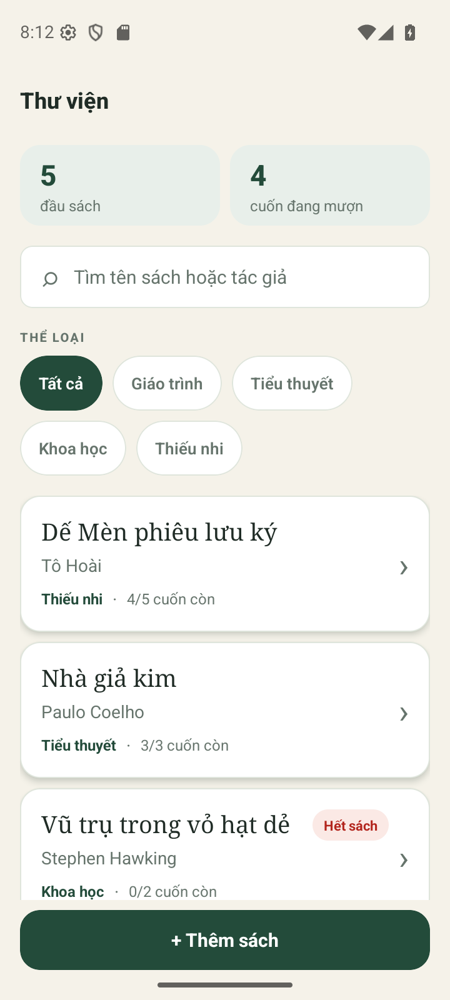
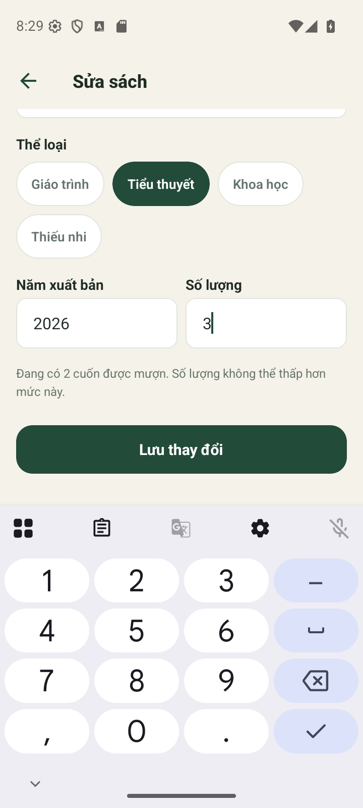

# APP_Mid_Term — Ứng dụng quản lý thư viện

**Sinh viên:** Trần Ngọc Linh — **MSSV:** B23DCC097  
**Lớp:** chưa được cung cấp.

Ứng dụng React Native CLI quản lý sách offline. Dữ liệu được lưu trên thiết bị bằng AsyncStorage; không cần tài khoản, backend hay kết nối mạng.

## Môi trường và chạy Android

Toolchain đã dùng để kiểm tra bản Android trong workspace: Node.js 24.15.0, JDK 21.0.6, Gradle 8.14.1, React Native 0.80.3, Android compile SDK 35 và NDK 27.1. Cần cài Android SDK Platform 35 cùng NDK 27.1 trong Android Studio SDK Manager, đồng thời cấu hình `ANDROID_HOME`/`ANDROID_SDK_ROOT` và PATH cho platform-tools.

```powershell
cd LibraryApp
npm ci
npx react-native run-android
```

Nếu CLI không tự chạy Metro, mở hai terminal tại `LibraryApp`:

```powershell
# Terminal 1
npm start
```

```powershell
# Terminal 2
npx react-native run-android
```

Từ thư mục gốc của repository, chạy `powershell -ExecutionPolicy Bypass -File .\scripts\check-submission.ps1` để kiểm tra file đã track, Jest, TypeScript và ESLint. Script chỉ đọc trạng thái Git và chạy các lệnh kiểm tra.

Máy này có Java IDE Gradle importer bị tắt trong `.vscode/settings.json`: importer đang dùng Java 25, không tương thích với Gradle 8.14.1. Dùng JDK 17/21 trong Android Studio hoặc chạy Gradle qua CLI; không nâng Gradle lên 9 để vượt qua importer.

iOS chỉ có thể build/chạy trên macOS đã cài Xcode và CocoaPods:

```sh
cd LibraryApp
npm ci
bundle install
cd ios
BUNDLE_GEMFILE=../Gemfile bundle exec pod install
cd ..
npx react-native run-ios
```

## Ghi chú audit dependency

Audit snapshot ngày **2026-10-28**, tạo bằng `npm audit --json` trong `LibraryApp`; raw output: [docs/evidence/npm-audit.json](docs/evidence/npm-audit.json). Toolchain audit ghi nhận 15 findings: 8 mức low, 6 moderate và 1 high. Finding high là `image-size@1.2.1` được dùng qua Metro. Bản patched v2 đổi callable API, vì vậy không ép override sang v2 một cách mù quáng: việc đó có thể làm hỏng consumer. Cần xác minh tương thích và cách nâng cấp ở upstream trước khi thay đổi dependency; finding này được ghi nhận là giới hạn còn lại.

## Tính năng

- Danh sách sách mẫu (5 đầu sách, đủ bốn thể loại) chỉ được tạo khi AsyncStorage chưa có key. Kho đã lưu `[]` được giữ nguyên.
- Tìm theo tên/tác giả và lọc thể loại đồng thời; xem số lượng còn, mượn và trả sách.
- Thêm, sửa, xoá có xác nhận; không thể xoá sách đang có người mượn.
- Dữ liệu lưu cục bộ. Nếu đọc lỗi, ứng dụng giữ thao tác ở trạng thái an toàn và cho tải lại. Nếu ghi lỗi, lỗi được hiển thị và có thể thử lưu snapshot mới nhất.

## Cấu trúc mã nguồn

| Thư mục/file | Vai trò |
| --- | --- |
| `LibraryApp/src/types/` | Kiểu sách và thể loại |
| `LibraryApp/src/domain/` | Quy tắc nghiệp vụ, validation và lọc thuần |
| `LibraryApp/src/data/` | Seed và repository AsyncStorage |
| `LibraryApp/src/state/` | Context state và ref dùng chung để cập nhật đồng bộ |
| `LibraryApp/src/screens/` | Danh sách, chi tiết, form thêm/sửa |
| `LibraryApp/src/components/` và `theme/` | Component giao diện và token thiết kế |
| `LibraryApp/__tests__/` | Test domain, storage, provider tích hợp và screen |

## Bảng tiêu chí và hồ sơ kiểm tra

Bảng chấm bảy câu, điểm và đường dẫn source: [docs/CHAM_DIEM.md](docs/CHAM_DIEM.md). Kịch bản trình diễn 5–7 phút: [docs/DEMO.md](docs/DEMO.md).

### Kết quả xác minh

- **Automated:** 31/31 tests trong 6 suites, TypeScript, ESLint và tracked-file gate đều exit 0. Xem [log kiểm tra](docs/evidence/submission-check.txt).
- **Native QA:** Android API 36 emulator, viewport 360 × 800 dp. Đã xác minh CRUD, search kết hợp lọc thể loại, Alert xoá, trạng thái disabled màu xám, bàn phím số với ô cuối và nút lưu còn nhìn thấy, persistence sau cold restart gồm dữ liệu sửa/thêm/xoá, và kho `[]` vẫn rỗng sau khi khởi động lại. Không có `FATAL EXCEPTION` trong crash buffer sau khi chạy các luồng đã kiểm tra.
- **Giới hạn:** kết quả crash chỉ áp dụng các luồng đã thử. iOS và thiết bị Android thật/khác emulator chưa kiểm chứng; APK là debug cho emulator, không phải gói phát hành. Hồ sơ chi tiết, kết quả theo luồng và ảnh chụp nằm ở [docs/QA_NATIVE.md](docs/QA_NATIVE.md).

Ảnh chụp QA:





Bài được bàn giao bằng Git theo yêu cầu cập nhật của người dùng thay cho ZIP trong đề gốc.
